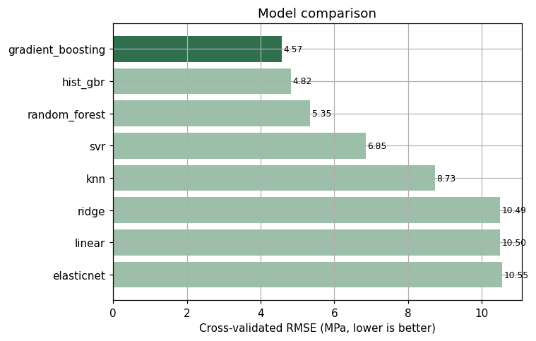
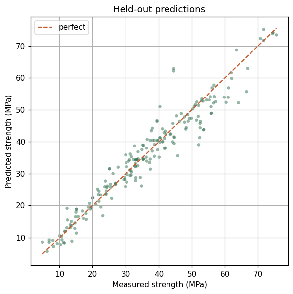
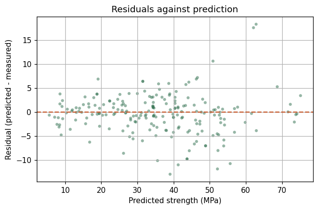
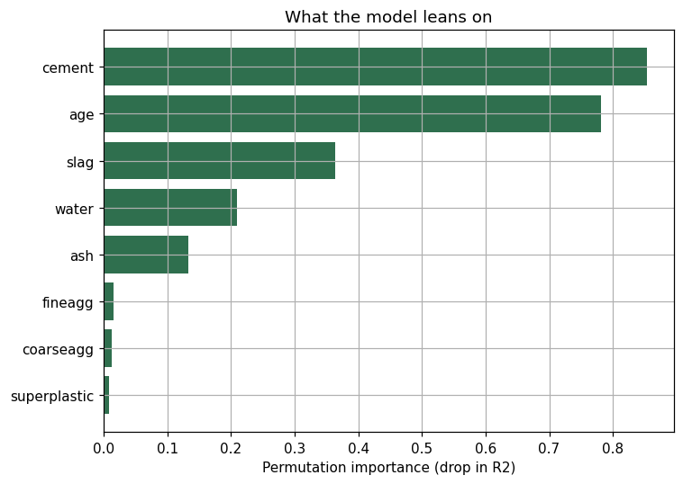
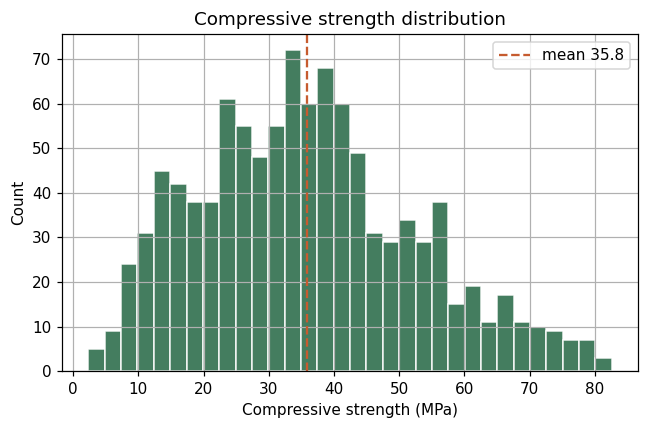
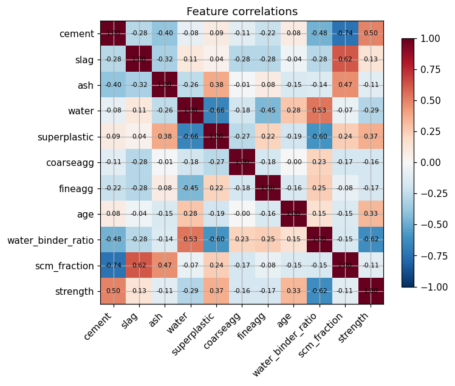

# curecast

[](https://github.com/ranjithguggilla/curecast/actions/workflows/ci.yml)
[](https://www.python.org/)
[](LICENSE)

Predict the compressive strength of a concrete mix from its recipe, then work
the problem backwards: given a strength you need to hit, find the mix that gets
there with the least embodied carbon.

Cement is responsible for somewhere around 8% of global CO2 emissions, and most
of that comes from the clinker in ordinary Portland cement. Every kilogram of
cement you can replace with an industrial by-product like blast-furnace slag or
fly ash, without dropping below the strength the structure needs, is carbon and
money you get to keep. That trade-off is fiddly to do by hand because strength
does not move linearly with any single ingredient. curecast learns the
relationship from 1,030 real laboratory mixes and turns it into two things a
batching plant can use: a fast strength estimate for any recipe, and a search
that returns the greenest recipe meeting a target.

## What it does

- Estimates 28-day-style compressive strength (MPa) from the eight standard mix
  inputs and curing age.
- Explains each estimate in plain terms a technologist would recognise, so the
  number is not a black box.
- Optimises a mix for a strength target, minimising embodied carbon while
  staying inside the physical envelope the model was actually trained on.
- Quantifies the carbon and cost saved against a conventional high-clinker mix.
- Ships a small Gradio app so someone can try both without touching code.

## Results

All numbers below come from a single held-out test split of 206 mixes that no
model saw during training. They are regenerated every run by
`python -m curecast.train` and written to `assets/metrics.json`, so nothing here
is hand-typed.

### Model comparison

Eight candidates were compared with 5-fold cross-validation on the training
split, scored by RMSE in MPa. Gradient boosting came out ahead, but I kept the
plain linear model in the race on purpose: if a model with eight coefficients
had matched the ensemble, it would have shipped, because it is far easier to
defend to an engineer. It did not come close, which is itself worth knowing.

| model | cv R2 | cv RMSE (MPa) | cv MAE (MPa) |
|-------|------:|--------------:|-------------:|
| gradient_boosting | 0.926 | 4.57 | 3.08 |
| hist_gbr | 0.918 | 4.82 | 2.99 |
| random_forest | 0.899 | 5.35 | 3.69 |
| svr | 0.835 | 6.85 | 4.81 |
| knn | 0.732 | 8.73 | 6.32 |
| ridge | 0.613 | 10.49 | 8.24 |
| linear | 0.612 | 10.50 | 8.24 |
| elasticnet | 0.608 | 10.55 | 8.31 |



### Held-out performance

The winner, refit on the full training split and measured once on the test
split:

| metric | gradient boosting | mean-only baseline |
|--------|------------------:|-------------------:|
| R2 | 0.933 | 0.000 |
| RMSE (MPa) | 4.14 | 16.05 |
| MAE (MPa) | 2.89 | 13.05 |

A typical prediction lands within about 2.9 MPa of the real value, against a
strength range that runs from 2.3 to 82.6 MPa. The mean-only column is the
honest floor: predict the average every time and RMSE is 16 MPa, so the model
is removing roughly three-quarters of the error a naive guess would carry.



The residuals stay close to symmetric around zero across the range, with a mild
tendency to under-predict the very strongest mixes, which are thin on the
ground in the data.



### What drives strength

Permutation importance on the held-out split, measured as the drop in R2 when a
column is shuffled:

| input | importance |
|-------|-----------:|
| cement | 0.85 |
| age | 0.78 |
| slag | 0.36 |
| water | 0.21 |
| fly ash | 0.13 |
| fine aggregate | 0.02 |
| coarse aggregate | 0.01 |
| superplasticiser | 0.01 |



Cement and curing age dominate, which matches the chemistry: more binder and
more time both mean more of the reaction that gives concrete its strength. The
model also leans on slag and water, the two levers the optimiser uses most.

### Exploratory view

Strength is mildly right-skewed (skew 0.42) with a mean of 35.8 MPa. Cement has
the strongest single correlation with strength (r = 0.50); water is the
strongest negative (r = -0.29), which is the water-to-binder story showing up in
the raw numbers.




### The carbon case

The optimiser was asked for the greenest mix reaching 40 MPa at 28 days and
compared against a conventional 480 kg/m3 all-cement mix of the same target.

| | high-clinker baseline | curecast mix |
|--|----------------------:|-------------:|
| cement (kg/m3) | 480 | 160 |
| slag + fly ash (kg/m3) | 0 | 240 |
| predicted strength (MPa) | - | 44.5 |
| embodied carbon (kg CO2e/m3) | 454.6 | 178.3 |
| material cost ($/m3) | 103.0 | 85.4 |

That is a 60.8% cut in embodied carbon and a 17.1% cut in material cost, on a
mix the model predicts will clear the target with margin. On a mid-size pour of
1,000 cubic metres, the carbon difference is about 276 tonnes of CO2e, roughly
what 60 petrol cars put out in a year. The carbon and price factors behind these
figures live in one place, `config.py`, and are order-of-magnitude industry
values rather than vendor quotes, so treat the percentages as the headline and
the absolute dollars as directional.

## Architecture

```
                 concrete.csv (1,030 mixes)
                          |
                   data.load_dataset
                 (schema + range checks)
                          |
              +-----------+-----------+
              |                       |
        eda.run_eda            features.MixFeatureBuilder
     (pingouin stats,          (row-wise ratios: w/b,
      charts)                   binder, scm fraction, ...)
                                        |
                                  model.build_model_zoo
                             (8 pipelines, scaler inside)
                                        |
                                 train.main
                    (5-fold CV -> pick winner -> refit -> test)
                                        |
                    +-------------------+-------------------+
                    |                   |                   |
          assets/curecast_model    assets/metrics.json  assets/*.png
                    |
        +-----------+-----------+
        |                       |
   scoring.score_mix     optimize.optimise_mix
   (strength, carbon,    (grid search inside the
    cost, reasons)        trained-data envelope)
        |                       |
        +-----------+-----------+
                    |
                 app (Gradio)
```

## Installation

```bash
git clone https://github.com/ranjithguggilla/curecast.git
cd curecast
python -m venv .venv && source .venv/bin/activate
pip install -r requirements-dev.txt
pip install -e .
```

Python 3.10 or newer.

## Usage

Train everything from scratch. This validates the data, runs the exploratory
pass, compares the model zoo, refits the winner, measures it on the held-out
split, writes `assets/metrics.json`, saves the model, and regenerates every
chart:

```bash
python -m curecast.train
```

Score a single mix from Python:

```python
from curecast.scoring import score_mix

card = score_mix({
    "cement": 350, "slag": 80, "ash": 60, "water": 180,
    "superplastic": 6, "coarseagg": 968, "fineagg": 773, "age": 28,
})
print(card["predicted_strength_mpa"], "MPa")
for reason in card["reasons"]:
    print("-", reason)
```

Ask for the greenest mix that reaches a target:

```python
from curecast.optimize import optimise_mix

best = optimise_mix(target_strength=45, age=28)
print(best.predicted_strength, "MPa at", best.co2, "kg CO2e/m3")
print(best.mix)
```

Launch the app (two tabs: score a mix, and optimise for a target):

```bash
python -m curecast.app
```

After an editable install the two console scripts `curecast-train` and
`curecast-app` do the same thing.

## Configuration

Everything tunable sits in `src/curecast/config.py`:

- `RANDOM_STATE`, `TEST_SIZE`, `CV_FOLDS` control the split and validation.
- `CO2_FACTORS` and `COST_PER_TONNE` hold the carbon and price assumptions used
  by the scorer and optimiser. Change these to your own supplier data and every
  downstream number follows.
- `_BOUNDS` in `data.py` is the physical envelope used both to reject bad rows
  and, in `optimize.py`, to keep the optimiser from recommending a mix the model
  never saw.

## Output structure

```
assets/
  curecast_model.joblib     trained pipeline (rebuilt by training and CI)
  metrics.json              every number quoted in this README
  model_comparison.png      cross-validated RMSE by model
  predicted_vs_actual.png   held-out predictions against measured strength
  residuals.png             residuals against prediction
  feature_importance.png    permutation importance
  target_distribution.png   strength histogram
  correlation_heatmap.png   feature correlations
```

## Project structure

```
curecast/
  src/curecast/
    config.py        paths, schema, carbon and cost factors
    data.py          loading and strict validation
    features.py      row-wise ratio features as a sklearn transformer
    model.py         the eight-model zoo and pipeline factory
    evaluate.py      metrics and plain-language reason codes
    optimize.py      envelope-constrained mix search
    scoring.py       the single scoring entry point the app calls
    plots.py         chart helpers
    eda.py           exploratory pass with pingouin
    train.py         the end-to-end run
    app.py           Gradio interface
  tests/             pytest suite
  data/              concrete.csv and its provenance
  assets/            model, metrics, charts
```

## Technical details

The whole model is one scikit-learn `Pipeline`, so preprocessing is never fit on
data it should not see. The first step builds six ratio features that materials
engineers already reason with (water-to-binder, total binder, the fraction of
binder made up by slag and fly ash, and so on). Each is computed from a single
row, which means there is no path for information to leak across the
train/test boundary even before the pipeline enforces it. Linear and
distance-based candidates get a `StandardScaler` inside the same pipeline; the
tree ensembles skip it because they do not need it. Because the transform lives
in the pipeline, the exact same maths runs when the served model scores a mix a
user typed in.

Model selection is 5-fold cross-validation on the training split only, scored by
RMSE. The winner is refit on the full training data and touched to the test
split exactly once. I report a mean-only baseline alongside it so the headline
R2 has a floor to stand against.

The optimiser is a constrained grid search over binder content, the slag-plus-ash
fraction of that binder, and the water-to-binder ratio. Every candidate is
scored by the trained model, and any candidate whose water, binder, or cement
falls outside the range present in the training data is thrown out before it can
be recommended. That envelope check is the difference between a suggestion an
engineer can act on and a confident extrapolation into mixes the model has never
seen.

## Testing

```bash
pytest
ruff check .
```

The suite covers data validation and its failure modes, the feature maths, the
model zoo wiring (including that scalers live inside pipelines), the scoring
card, and the optimiser (that it meets modest targets, stays inside the
envelope, and beats the baseline on carbon). The tests train a small model in a
fixture rather than depending on a serialised file, so they pass on a clean
checkout with no prior training run.

## Dataset

I-Cheng Yeh, "Modeling of strength of high performance concrete using artificial
neural networks," Cement and Concrete Research, 28(12), 1797-1808, 1998. Curated
on the UCI Machine Learning Repository as "Concrete Compressive Strength."
Retrieved from the vendored copy at
https://github.com/stedy/Machine-Learning-with-R-datasets. See `data/README.md`
for the column dictionary.

## License

MIT. See [LICENSE](LICENSE).
